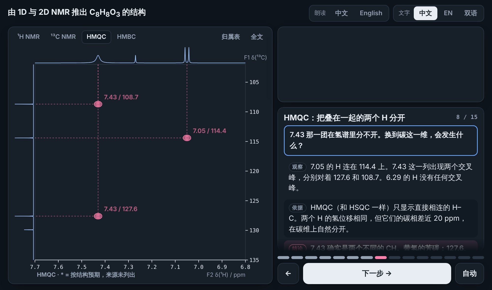
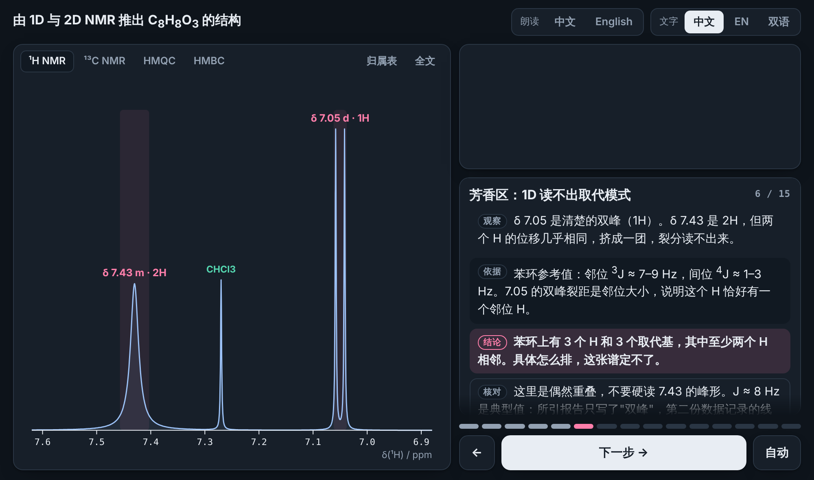
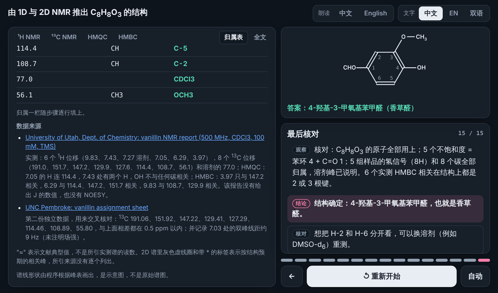

# nmr-walkthrough

**点一下，动一步的 NMR 解谱讲解。** 一个 MCP 服务器加一个 Skill，让你的编程助手把核磁解谱题做成可以点击推进的双语网页：每点一下，谱图放大并高亮一个信号，结构多长出一块，旁边给出"观察、依据、结论、核对"四句讲解。

**Click-to-advance NMR walkthroughs.** An MCP server plus a skill that make your coding agent explain an NMR structure problem as a bilingual web page: each click zooms into one signal, grows the structure by one piece and shows four short beats (Observe, Rule, So, Check).


完整演示视频（97 秒，MP4）/ full demo video: [docs/media/demo.mp4](docs/media/demo.mp4)

## 底线：数据必须真实 / Ground rule: real data only

- 每一个位移、J 值和相关峰都必须来自你自己的谱图或峰表，或者来自注明出处的实测数据。没有 `sources` 的讲解，生成工具直接拒绝。
- 来源没给的值会在页面上标出：`≈` 是文献典型值，2D 谱里灰色虚线圈加 `*` 是按结构预期的峰。
- 来源里没有的谱（比如 NOESY）不画。
- 谱线形状是程序按峰表画的示意图（洛伦兹线形加一级裂分）。位移是真的，峰形不是原始谱图。

Every shift, J value and cross peak must come from your own spectra or peak list, or from a cited measured source. A spec without `sources` is rejected. Values a source does not give are marked on the page (`≈` typical literature value, grey dashed ring with `*` for an expected 2D peak). Spectra a source lacks are not drawn. Line shapes are schematic, computed from the peak list.

## 长什么样 / What it looks like

| | |
|---|---|
|  关键步骤先提问，自己想一想再看答案 / key steps ask first |  2D 谱带投影，高亮当前相关峰 / 2D maps with projections |
|  放大拥挤区域，四句讲解 / zoom plus the four beats |  结构随推理一块块长出来，箭头标出相关 / the structure grows as deduced |
|  最后核对并给出答案 / final check and answer |  归属表底部列出数据来源 / sources under the table |
|  中文、English、双语，深色和浅色 / three text modes, dark and light | |

功能 / Features

- 一屏完成学习，按平板横屏设计，手机上自动改成上下排列。
- 文字可选中文、English 或双语。朗读每次一种语言，用设备自带的系统语音。
- 1D 谱（¹H、¹³C 等）和 2D 谱（COSY、HSQC/HMQC、HMBC、TOCSY、NOESY）。
- 归属表随步骤逐行填上，另有全文讲稿。
- 生成的是一个不依赖网络的 HTML 文件，可以直接打开，也可以发布成 Claude Artifact。

## 安装 / Install

需要 Node.js 18 或更高版本，没有其他依赖。先把仓库克隆到一个固定位置：

```bash
git clone https://github.com/FelixJiashengFu/nmr-walkthrough.git
cd nmr-walkthrough
npm test   # 可选：自检
```

然后按你用的工具运行 `node scripts/install.mjs <工具名>`。脚本会把 Skill 复制到该工具的用户级技能目录，并把 MCP 服务器写进它的配置文件（保留已有的其他服务器）。只能在界面里添加的工具，脚本会打印出要粘贴的内容。加 `--dry-run` 可以只看不改。

也可以不克隆：到 [Releases](https://github.com/FelixJiashengFu/nmr-walkthrough/releases) 下载 `nmr-walkthrough.mcpb`（Claude Desktop 双击安装）或 `nmr-step-walkthrough-skill.zip`（自带生成器的技能文件夹，适合只能上传技能的工具）。

### 国内平台 / Chinese platforms

| 工具 Tool | 命令 Command | Skill 位置 | MCP 配置 |
|---|---|---|---|
| 豆包工作 Doubao Work | `doubao`（打印步骤） | 界面上传 `standalone-skill/` | 界面新建自定义连接器（HTTP） |
| Qoder（阿里） | `qoder` | `~/.qoder/skills/` | `~/.qoder/settings.json` |
| 通义灵码 Lingma | `lingma` | `~/.lingma/skills/` | 界面：个人设置 → MCP 服务 → 手工添加 |
| Qwen Code | `qwen` | `~/.qwen/skills/` | `~/.qwen/settings.json` |
| WorkBuddy（腾讯） | `workbuddy` | `~/.workbuddy/skills/` | `~/.workbuddy/mcp.json` |
| CodeBuddy（腾讯） | `codebuddy` | `~/.codebuddy/skills/` | `~/.codebuddy/mcp.json` |
| Trae（字节） | `trae`（打印步骤） | `~/.agents/skills/` | 界面：设置 → MCP → 手动添加，或项目里的 `.trae/mcp.json` |
| 文心快码 Comate（百度） | `comate` | `~/.comate/skills/` | `~/.comate/mcp.json` |
| Kimi Code CLI（月之暗面） | `kimi` | `~/.kimi-code/skills/` | `~/.kimi-code/mcp.json` |
| DeepSeek Harness | 插件，见下方 | 插件自带 | 插件自带 |
| Cherry Studio | `cherry`（打印步骤） | 不安装 | 界面里添加 STDIO 服务器 |

### 其他平台 / Other platforms

| 工具 Tool | 命令 Command | Skill 位置 | MCP 配置 |
|---|---|---|---|
| Claude Code | 插件，见下方 | 插件自带 | 插件自带 |
| Claude Desktop | 下载 `.mcpb` 双击 | 不需要 | 扩展自带 |
| Codex | `codex` | `~/.agents/skills/` | `~/.codex/config.toml` |
| Gemini CLI | `gemini extensions install https://github.com/FelixJiashengFu/nmr-walkthrough` | 扩展自带 | 扩展自带 |
| Antigravity | `antigravity` | `~/.gemini/config/skills/` | `~/.gemini/config/mcp_config.json` |
| Cursor | `cursor` | `~/.cursor/skills/` | `~/.cursor/mcp.json` |
| VS Code Copilot | `vscode` | `~/.copilot/skills/` | `~/.copilot/mcp-config.json` |
| Windsurf | `windsurf` | `~/.agents/skills/` | `~/.codeium/windsurf/mcp_config.json` |
| Kiro | `kiro` | `~/.kiro/skills/` | `~/.kiro/settings/mcp.json` |
| Cline | `cline` | `~/.cline/skills/` | `~/.cline/data/settings/cline_mcp_settings.json` |
| Zed | `zed`（打印步骤） | `~/.agents/skills/` | 设置文件里的 `context_servers` |
| opencode | `opencode`（打印命令） | `~/.config/opencode/skills/` | `opencode mcp add` |
| 只要 Skill | `agents` | `~/.agents/skills/` | 无 |

所有写 JSON 的工具用的都是同一种写法，只是文件位置不同：

```json
{
  "mcpServers": {
    "nmr-walkthrough": { "command": "node", "args": ["/绝对路径/nmr-walkthrough/server.mjs"] }
  }
}
```

### Claude Code

```bash
claude plugin marketplace add FelixJiashengFu/nmr-walkthrough
claude plugin install nmr-walkthrough@nmr-walkthrough
```

插件同时带上 MCP 服务器和 Skill。不想用插件的话：`node scripts/install.mjs claude`，再按提示运行 `claude mcp add nmr-walkthrough --scope user -- node /绝对路径/server.mjs`。

### Codex

`node scripts/install.mjs codex`，或者手动在 `~/.codex/config.toml` 里加：

```toml
[mcp_servers.nmr-walkthrough]
command = "node"
args = ["/绝对路径/nmr-walkthrough/server.mjs"]
```

并把 `skills/nmr-step-walkthrough` 复制到 `~/.agents/skills/`（或项目里的 `.agents/skills/`）。

### Gemini CLI 和 Qwen Code 扩展

仓库根目录的 `gemini-extension.json` 让它可以作为扩展安装，一次带上 MCP 服务器和 Skill：

```bash
gemini extensions install https://github.com/FelixJiashengFu/nmr-walkthrough
qwen extensions install https://github.com/FelixJiashengFu/nmr-walkthrough   # Qwen Code 文档说会把 Gemini 扩展自动转换
```

### 各工具的补充说明

- Antigravity：也可以在智能体面板的"MCP Servers → Manage MCP Servers → View raw config"里粘贴。项目级位置是 `.agents/mcp_config.json` 和 `.agents/skills/`。
- Qoder：命令行也可以用 `qodercli mcp add nmr-walkthrough -s user -- node /绝对路径/server.mjs`。项目级位置是 `.mcp.json` 和 `.qoder/skills/`。
- WorkBuddy：也可以在"插件 → MCP 服务器 → 配置 MCP"里粘贴。Skill 也可以把 `SKILL.md` 拖进对话导入。
- CodeBuddy：项目级位置是项目里的 `.mcp.json` 和 `.codebuddy/skills/`。
- 文心快码：如果没有自动出现，在右上角"···"→ MCP →"手动配置"里粘贴。项目级位置是 `.comate/mcp.json` 和 `.comate/skills/`。
- Kimi Code CLI：设置了 `KIMI_CODE_HOME` 时以它为准。在 `kimi` 里运行 `/mcp-config` 可以检查服务器。项目级位置是 `.kimi-code/mcp.json` 和 `.kimi-code/skills/`。旧版 Kimi CLI 已归档，请用 Kimi Code。
- Trae：界面提示"命令中不能包含空格"，所以请把仓库放在没有空格的路径下。
- iFlow CLI 已于 2026 年 4 月停止服务，所以没有适配。

### DeepSeek Harness（DSH）

在 DSH 里打开"插件 → 添加插件"，填 `FelixJiashengFu/nmr-walkthrough` 或克隆下来的本地目录。命令行方式（先完全退出 DSH 桌面版）：

```bash
dsh plugin --profile desktop add github:FelixJiashengFu/nmr-walkthrough
```

`dsh/index.js` 是一个很小的宿主插件，用 DSH 自带的 MCP 客户端启动 `server.mjs`，并加载 `skills/` 里的 Skill。

### 豆包工作（Doubao Work）

豆包工作在自己的界面里添加技能和连接器，不读配置文件。分两步，第一步就够用。

**1. 上传技能（必做）。** 打开豆包电脑版，进入"技能 · 连接器 · 伙伴"，在"我的技能"里点右上角"新建 → 上传技能"，把仓库里的这个文件夹拖进去（或者用 Releases 里的 `nmr-step-walkthrough-skill.zip` 解压出来的文件夹）：

```
standalone-skill/nmr-step-walkthrough
```

这个文件夹是自带生成器的完整版技能（`SKILL.md` 加 `builder/`），不依赖连接器。之后在任务里说"用 nmr-step-walkthrough 讲这道题"，并附上你的谱图或峰表即可。

**2. 添加连接器（可选）。** 想让豆包通过 MCP 调用生成器，先用 HTTP 方式启动服务并保持运行：

```bash
node server.mjs --http 8765
```

然后在同一页面点"新建 → 新建自定义连接器"，传输类型选 HTTP，服务器 URL 填 `http://127.0.0.1:8765/mcp`。如果豆包工作连不上本机地址，就需要把服务部署到公网 HTTPS 地址，并设置环境变量 `NMR_MCP_TOKEN`，在连接器的自定义 Headers 里填 `Authorization: Bearer <你的令牌>`。

### 适配情况说明 / Compatibility notes

- MCP 服务器支持 stdio 和 HTTP（Streamable HTTP，`/mcp`）两种方式，自检和协议握手已在本仓库测试（`npm test`）。安装脚本对每种工具写出的文件也已测试。
- 各工具的配置路径取自它们的官方文档。以下几处官方文档没写清楚，用的是社区文章或通用位置：WorkBuddy 的 Skill 目录；Windsurf、Trae 没有写明 Skill 目录，所以放在通用的 `~/.agents/skills/`；文心快码只写了 MCP 文件位置和"手动配置"入口，JSON 写法按通用格式；Cherry Studio 的 MCP 帮助页写这份说明时打不开，只给出通用步骤。
- Qwen Code 的扩展转换、CodeBuddy 兼容 Claude Code 插件，都来自它们的文档描述，还没有实机验证。
- DeepSeek Harness 的插件按现有 DSH 0.2.x 插件的结构编写，还没有在真实的 DSH 里运行验证。DSH 仍是开发者预览版，接口可能变化。
- 豆包工作的官方帮助中心是动态页面，写这份说明时读不到正文。上面的菜单名称和步骤取自第三方教程；它是否支持本机命令方式（stdio）的连接器、能否访问 `127.0.0.1`、上传的技能里的脚本在本机还是云端运行，都没有查到官方说法，所以把自带生成器的技能作为主要方式。
- 这些工具里的实际加载效果还没有逐个实机测试。遇到问题请提 issue。

## 使用 / Use

装好后直接对助手说，例如：

> 用 nmr-step-walkthrough 讲一下这道题。这是我的 ¹H、¹³C、HSQC、HMBC 峰表：……

助手会先调用 `nmr_walkthrough_guide` 读讲解方法，写出 JSON 描述，再用 `build_nmr_walkthrough` 生成网页。**请把你自己的谱图或峰表给它。** 如果只给化合物名字，它必须先找到有出处的实测数据，找不到就应该停下来问你，而不是编数字。

| MCP 工具 | 作用 |
|---|---|
| `nmr_walkthrough_guide` | 返回讲解方法、数据格式和一个完整示例 |
| `validate_nmr_walkthrough` | 检查描述：缺数据来源、未归属的峰、没有结论的步骤等 |
| `build_nmr_walkthrough` | 生成一个自包含的 HTML 页面 |

不用 MCP 也可以直接用命令行：

```bash
node server.mjs --build examples/vanillin.json vanillin.html --standalone
```

## 示例 / Examples

- `examples/ethyl-crotonate.json`：入门。C₆H₁₀O₂，从 J 值读出 E 式双键，COSY 走一遍，HMBC 接上酯基。
- `examples/vanillin.json`：进阶。C₈H₈O₃，溶剂峰混在芳香区，两个氢重叠要靠 HMQC 拆开，HMBC 定位三个取代基，最后用碳位移规律在两个候选之间取舍。
- `examples/ibuprofen.json`：换个类型。C₁₃H₁₈O₂，60 MHz 台式谱，带实测 J 值；从裂分搭出异丁基，碳谱的对称性定出对位取代，HSQC-ME 拆开两个偶然重叠的碳，HMBC 分清两组芳碳。

多谱联用示例（¹H、¹³C 加 COSY、HSQC/HMQC、HMBC 一起解）：

- `examples/estragole.json`：入门。C₁₀H₁₂O，800 MHz。碳谱 10 个碳只有 8 个峰，从对称性读出对二取代苯环；COSY 看出烯丙基的耦合网（含两个四键远程耦合）；HMQC 分清 OCH₃ 邻位和间位的两对芳 CH。来源没有做 HMBC，最后一步说明了少了它会缺什么。
- `examples/pulegone.json`：中等。C₁₀H₁₆O，BMRB 500 MHz 数据。积分只数到 15 个 H，HSQC 找出藏在甲基单峰下面的那个 H；DEPT 分出碳的类型；8 个 HMBC 峰一步步把甲基、C=C 和环上的 CH₂ 接成环。J 值由记录里的谱线位置换算。
- `examples/melatonin.json`：进阶。C₁₃H₁₆N₂O₂，500 MHz，五种谱都有。氢谱少两个 H（N–H 交换掉了）；HMBC 搭出乙酰胺侧链；芳香区的 d、dd、d 加 COSY 定出取代位置；HMBC 把甲氧基放在 C5、把侧链放在吲哚的 C3。

每个示例的数据来源写在 JSON 的 `sources` 里，页面的归属表底部也会列出，并逐项说明来源给了什么、没给什么。来源没有给出的值都在页面上标了 ≈ 或 *。有几份来源是大学的学生实验报告，本身有个别笔误或缺项（比如褪黑素的报告没写溶剂），示例里都已注明。

Multi-spectrum examples (¹H and ¹³C solved together with COSY, HSQC/HMQC and HMBC): `estragole.json` (starter, 800 MHz, symmetry plus the allyl COSY network; the source has no HMBC), `pulegone.json` (intermediate, BMRB 500 MHz: a proton hidden under a methyl singlet, DEPT, eight HMBC peaks close the ring) and `melatonin.json` (advanced, all five spectra: exchanged N–H, an acetamide chain from HMBC, the indole substitution from COSY and HMBC).

## 文件 / Files

- `server.mjs` MCP 服务器和命令行
- `lib/player.html` 播放器模板，`lib/build.mjs` 校验与生成
- `skills/nmr-step-walkthrough/SKILL.md` Skill
- `STYLE-GUIDE.md` 讲解方法，`SCHEMA.md` 数据格式
- `standalone-skill/` 自带生成器的完整版技能（由 `scripts/pack-skill.mjs` 生成，给只能上传技能文件夹的工具用）
- `scripts/install.mjs` 各工具的安装脚本，`scripts/test.mjs` 自检
- `.claude-plugin/`、`.mcp.json` Claude Code 插件；`dsh/`、`cordis.patch.yml` DeepSeek Harness 插件
- `gemini-extension.json`、`GEMINI.md` Gemini CLI / Qwen Code 扩展；`manifest.json` Claude Desktop 扩展（由 `scripts/pack-mcpb.mjs` 打包）；`server.json` MCP Registry 登记信息
- `.github/workflows/` 自动测试和发布（推送 `v*` 标签时生成 Release）

## 致谢 / Credits

讲解的写法学自 [nmr.tips](https://nmr.tips) 的解答方式：一次只讲一个推理动作，先观察再下结论。本项目只借鉴方法，没有使用该网站的题目、文字或图片。

License: MIT
