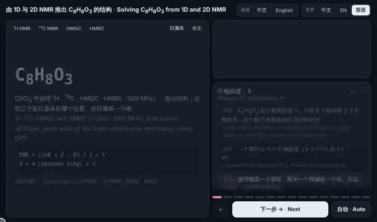
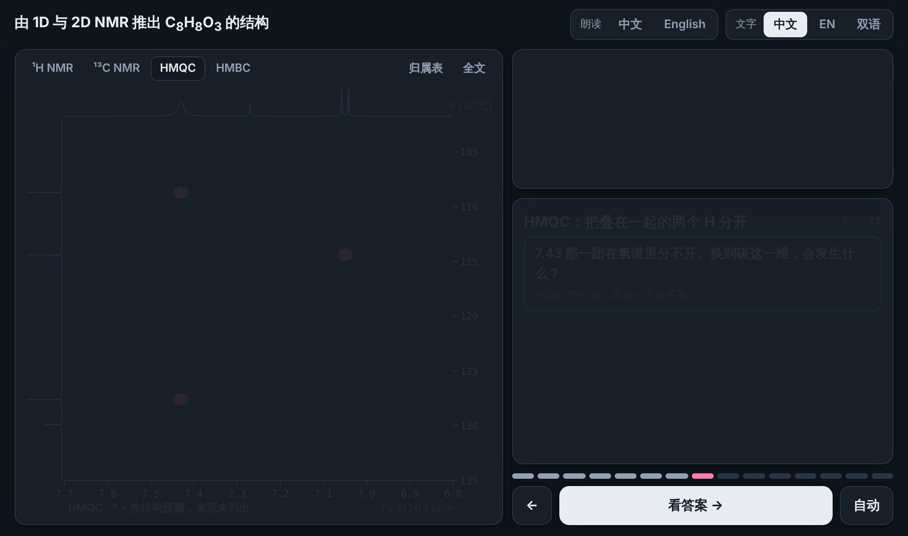
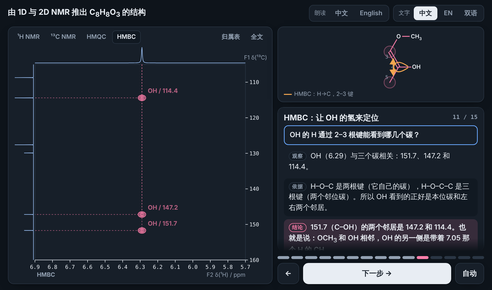
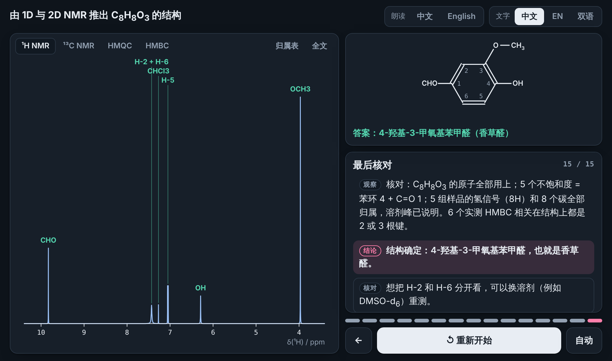
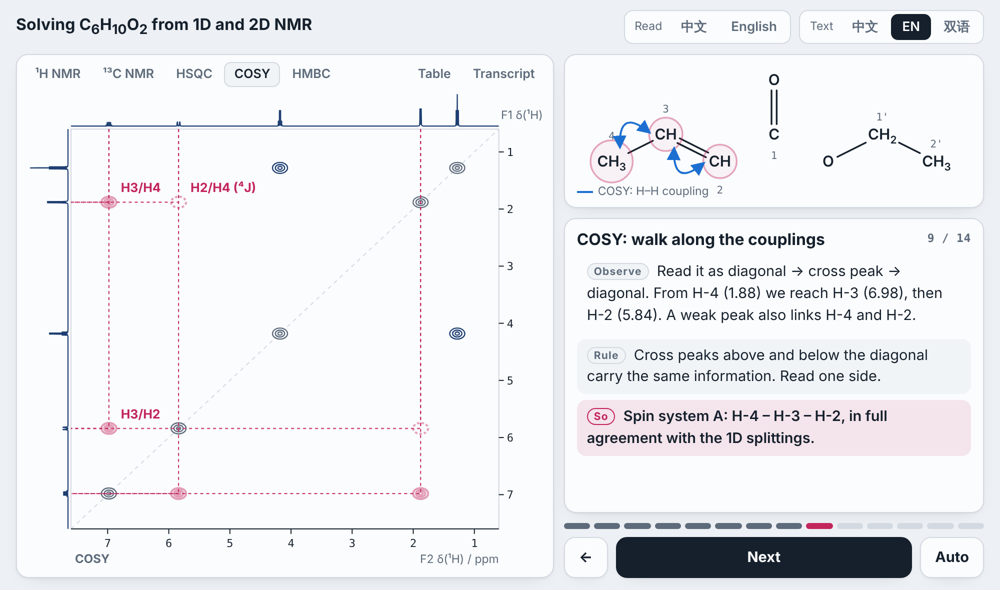

# nmr-walkthrough

**点一下，动一步的 NMR 解谱讲解。** 一个 MCP 服务器加一个 Skill，让你的编程助手把核磁解谱题做成可以点击推进的双语网页：每点一下，谱图放大并高亮一个信号，结构多长出一块，旁边给出"观察、依据、结论、核对"四句讲解。

**Click-to-advance NMR walkthroughs.** An MCP server plus a skill that make your coding agent explain an NMR structure problem as a bilingual web page: each click zooms into one signal, grows the structure by one piece and shows four short beats (Observe, Rule, So, Check).



完整演示视频（97 秒，MP4）/ full demo video: [docs/media/demo.mp4](docs/media/demo.mp4)

## 底线：数据必须真实 / Ground rule: real data only

- 每一个位移、J 值和相关峰都必须来自你自己的谱图或峰表，或者来自注明出处的实测数据。没有 `sources` 的讲解，生成工具直接拒绝。
- 来源没给的值会在页面上标出：`≈` 是文献典型值，2D 谱里灰色虚线圈加 `*` 是按结构预期的峰。
- 来源里没有的谱（比如 NOESY）不画。
- 谱线形状是程序按峰表画的示意图（洛伦兹线形加一级裂分）。位移是真的，峰形不是原始谱图。

Every shift, J value and cross peak must come from your own spectra or peak list, or from a cited measured source. A spec without `sources` is rejected. Values a source does not give are marked on the page (`≈` typical literature value, grey dashed ring with `*` for an expected 2D peak). Spectra a source lacks are not drawn. Line shapes are schematic, computed from the peak list.

## 长什么样 / What it looks like

| | |
|---|---|
|  关键步骤先提问，自己想一想再看答案 / key steps ask first |  2D 谱带投影，高亮当前相关峰 / 2D maps with projections |
|  放大拥挤区域，四句讲解 / zoom plus the four beats |  结构随推理一块块长出来，箭头标出相关 / the structure grows as deduced |
|  最后核对并给出答案 / final check and answer |  归属表底部列出数据来源 / sources under the table |
|  中文、English、双语，深色和浅色 / three text modes, dark and light | |

功能 / Features

- 一屏完成学习，按平板横屏设计，手机上自动改成上下排列。
- 文字可选中文、English 或双语。朗读每次一种语言，用设备自带的系统语音。
- 1D 谱（¹H、¹³C 等）和 2D 谱（COSY、HSQC/HMQC、HMBC、TOCSY、NOESY）。
- 归属表随步骤逐行填上，另有全文讲稿。
- 生成的是一个不依赖网络的 HTML 文件，可以直接打开，也可以发布成 Claude Artifact。

## 安装 / Install

需要 Node.js 18 或更高版本，没有其他依赖。先把仓库克隆到一个固定位置：

```bash
git clone https://github.com/FelixJiashengFu/nmr-walkthrough.git
cd nmr-walkthrough
npm test   # 可选：自检
```

然后按你用的工具选一种。安装脚本会把 Skill 复制到该工具的用户级技能目录，并把 MCP 服务器写进它的配置文件（保留已有的其他服务器）。加 `--dry-run` 可以只看不改。

| 工具 Tool | 一条命令 One command | Skill 位置 | MCP 配置 |
|---|---|---|---|
| Claude Code | 见下方插件方式 | 插件自带 | 插件自带 |
| Codex | `node scripts/install.mjs codex` | `~/.agents/skills/` | `~/.codex/config.toml` |
| Antigravity | `node scripts/install.mjs antigravity` | `~/.gemini/config/skills/` | `~/.gemini/config/mcp_config.json` |
| Qoder | `node scripts/install.mjs qoder` | `~/.qoder/skills/` | `~/.qoder/settings.json` |
| WorkBuddy | `node scripts/install.mjs workbuddy` | `~/.workbuddy/skills/` | `~/.workbuddy/mcp.json` |
| DeepSeek Harness | 见下方插件方式 | 插件自带 | 插件自带 |
| 豆包工作 Doubao Work | `node scripts/install.mjs doubao`（显示步骤） | 在界面里上传 | 在界面里新建连接器 |

### Claude Code

```bash
claude plugin marketplace add FelixJiashengFu/nmr-walkthrough
claude plugin install nmr-walkthrough@nmr-walkthrough
```

插件同时带上 MCP 服务器和 Skill。不想用插件的话：`node scripts/install.mjs claude`，再按提示运行 `claude mcp add nmr-walkthrough --scope user -- node /绝对路径/server.mjs`。

### Codex

`node scripts/install.mjs codex`，或者手动在 `~/.codex/config.toml` 里加：

```toml
[mcp_servers.nmr-walkthrough]
command = "node"
args = ["/绝对路径/nmr-walkthrough/server.mjs"]
```

并把 `skills/nmr-step-walkthrough` 复制到 `~/.agents/skills/`（或项目里的 `.agents/skills/`）。

### Antigravity、Qoder、WorkBuddy

这三个工具用同一种 JSON 写法，只是文件位置不同（见上表）：

```json
{
  "mcpServers": {
    "nmr-walkthrough": { "command": "node", "args": ["/绝对路径/nmr-walkthrough/server.mjs"] }
  }
}
```

- Antigravity：也可以在智能体面板的"MCP Servers → Manage MCP Servers → View raw config"里粘贴。项目级位置是 `.agents/mcp_config.json` 和 `.agents/skills/`。
- Qoder：命令行也可以用 `qodercli mcp add nmr-walkthrough -s user -- node /绝对路径/server.mjs`。项目级位置是 `.mcp.json` 和 `.qoder/skills/`。
- WorkBuddy：也可以在"插件 → MCP 服务器 → 配置 MCP"里粘贴。Skill 也可以把 `SKILL.md` 拖进对话导入。

### DeepSeek Harness（DSH）

在 DSH 里打开"插件 → 添加插件"，填 `FelixJiashengFu/nmr-walkthrough` 或克隆下来的本地目录。命令行方式（先完全退出 DSH 桌面版）：

```bash
dsh plugin --profile desktop add github:FelixJiashengFu/nmr-walkthrough
```

`dsh/index.js` 是一个很小的宿主插件，用 DSH 自带的 MCP 客户端启动 `server.mjs`，并加载 `skills/` 里的 Skill。

### 豆包工作（Doubao Work）

豆包工作在自己的界面里添加技能和连接器，不读配置文件。分两步，第一步就够用。

**1. 上传技能（必做）。** 打开豆包电脑版，进入"技能 · 连接器 · 伙伴"，在"我的技能"里点右上角"新建 → 上传技能"，把仓库里的这个文件夹拖进去：

```
standalone-skill/nmr-step-walkthrough
```

这个文件夹是自带生成器的完整版技能（`SKILL.md` 加 `builder/`），不依赖连接器。之后在任务里说"用 nmr-step-walkthrough 讲这道题"，并附上你的谱图或峰表即可。

**2. 添加连接器（可选）。** 想让豆包通过 MCP 调用生成器，先用 HTTP 方式启动服务并保持运行：

```bash
node server.mjs --http 8765
```

然后在同一页面点"新建 → 新建自定义连接器"，传输类型选 HTTP，服务器 URL 填 `http://127.0.0.1:8765/mcp`。如果豆包工作连不上本机地址，就需要把服务部署到公网 HTTPS 地址，并设置环境变量 `NMR_MCP_TOKEN`，在连接器的自定义 Headers 里填 `Authorization: Bearer <你的令牌>`。

### 适配情况说明 / Compatibility notes

- MCP 服务器支持 stdio 和 HTTP（Streamable HTTP，`/mcp`）两种方式，自检和协议握手已在本仓库测试（`npm test`）。安装脚本对每种工具写出的文件也已测试。
- 各工具的配置路径取自它们的官方文档（Codex、Antigravity、Qoder，以及 WorkBuddy 的 MCP 部分）。WorkBuddy 的 Skill 目录 `~/.workbuddy/skills/` 来自社区文章，官方文档没有写明。
- DeepSeek Harness 的插件按现有 DSH 0.2.x 插件的结构编写，还没有在真实的 DSH 里运行验证。DSH 仍是开发者预览版，接口可能变化。
- 豆包工作的官方帮助中心是动态页面，写这份说明时读不到正文。上面的菜单名称和步骤取自第三方教程；它是否支持本机命令方式（stdio）的连接器、能否访问 `127.0.0.1`、上传的技能里的脚本在本机还是云端运行，都没有查到官方说法，所以把自带生成器的技能作为主要方式。
- 在这七个工具里的实际加载效果还没有逐个实机测试。遇到问题请提 issue。

## 使用 / Use

装好后直接对助手说，例如：

> 用 nmr-step-walkthrough 讲一下这道题。这是我的 ¹H、¹³C、HSQC、HMBC 峰表：……

助手会先调用 `nmr_walkthrough_guide` 读讲解方法，写出 JSON 描述，再用 `build_nmr_walkthrough` 生成网页。**请把你自己的谱图或峰表给它。** 如果只给化合物名字，它必须先找到有出处的实测数据，找不到就应该停下来问你，而不是编数字。

| MCP 工具 | 作用 |
|---|---|
| `nmr_walkthrough_guide` | 返回讲解方法、数据格式和一个完整示例 |
| `validate_nmr_walkthrough` | 检查描述：缺数据来源、未归属的峰、没有结论的步骤等 |
| `build_nmr_walkthrough` | 生成一个自包含的 HTML 页面 |

不用 MCP 也可以直接用命令行：

```bash
node server.mjs --build examples/vanillin.json vanillin.html --standalone
```

## 示例 / Examples

- `examples/ethyl-crotonate.json`：入门。C₆H₁₀O₂，从 J 值读出 E 式双键，COSY 走一遍，HMBC 接上酯基。
- `examples/vanillin.json`：进阶。C₈H₈O₃，溶剂峰混在芳香区，两个氢重叠要靠 HMQC 拆开，HMBC 定位三个取代基，最后用碳位移规律在两个候选之间取舍。
- `examples/ibuprofen.json`：换个类型。C₁₃H₁₈O₂，60 MHz 台式谱，带实测 J 值；从裂分搭出异丁基，碳谱的对称性定出对位取代，HSQC-ME 拆开两个偶然重叠的碳，HMBC 分清两组芳碳。

三个示例的数据来源写在各自 JSON 的 `sources` 里，页面的归属表底部也会列出。其中两份来源是大学的学生实验报告，本身有个别笔误，示例里对不上的地方都已注明。

## 文件 / Files

- `server.mjs` MCP 服务器和命令行
- `lib/player.html` 播放器模板，`lib/build.mjs` 校验与生成
- `skills/nmr-step-walkthrough/SKILL.md` Skill
- `STYLE-GUIDE.md` 讲解方法，`SCHEMA.md` 数据格式
- `standalone-skill/` 自带生成器的完整版技能（由 `scripts/pack-skill.mjs` 生成，给只能上传技能文件夹的工具用）
- `scripts/install.mjs` 各工具的安装脚本，`scripts/test.mjs` 自检
- `.claude-plugin/`、`.mcp.json` Claude Code 插件；`dsh/`、`cordis.patch.yml` DeepSeek Harness 插件

## 致谢 / Credits

讲解的写法学自 [nmr.tips](https://nmr.tips) 的解答方式：一次只讲一个推理动作，先观察再下结论。本项目只借鉴方法，没有使用该网站的题目、文字或图片。

License: MIT
